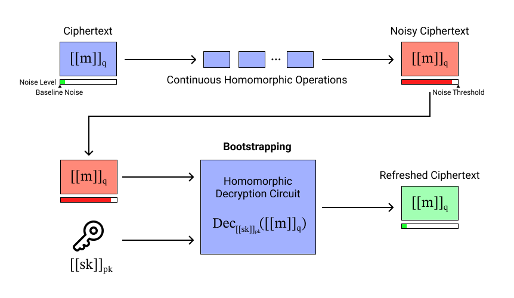
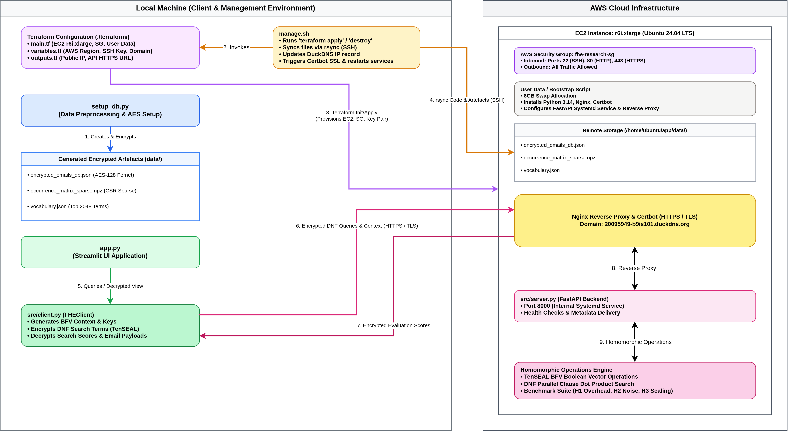
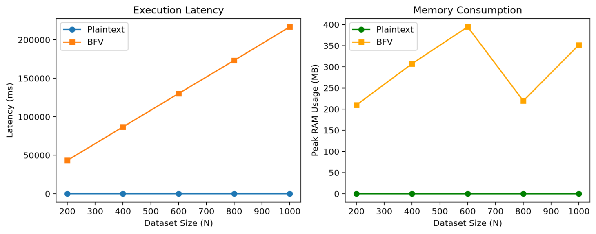
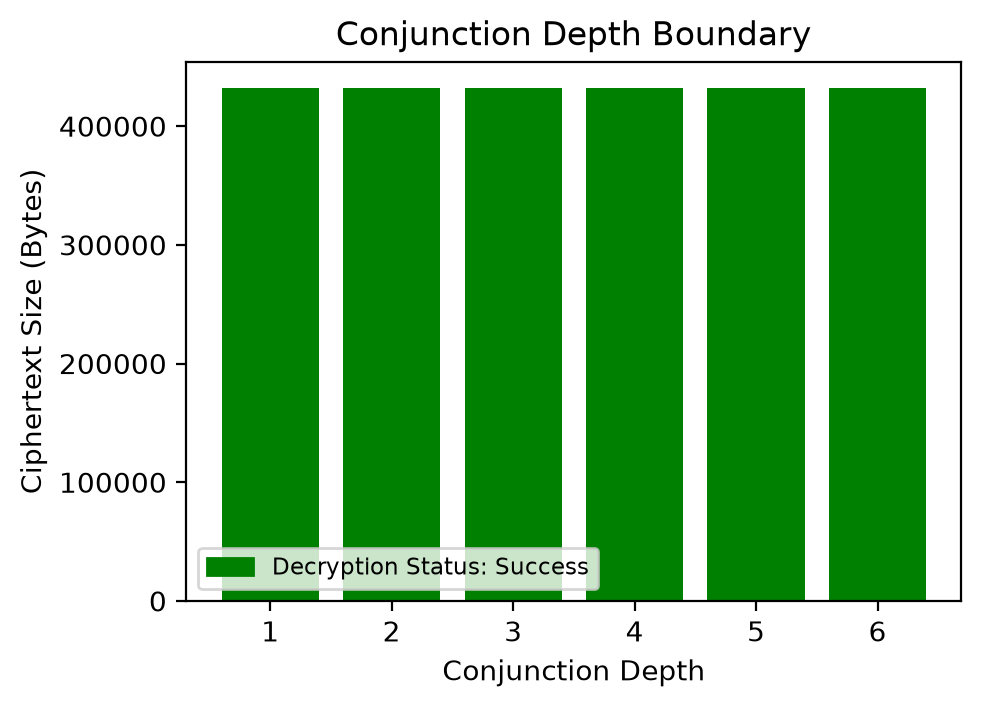
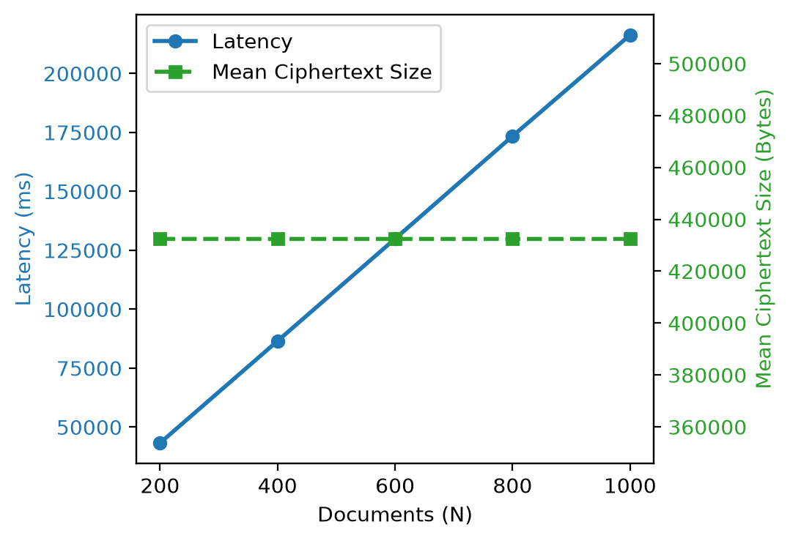
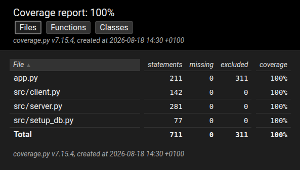

# Quantifying the Privacy Tax: Performance Trade-offs of BFV-Based Searchable Encryption in Cloud Storage

**Dublin Business School**  
**MSc in Information Systems with Computing**  
**Applied Research Project - B9IS101**  
**Year 1, Semester 3**  
**Continuous Assessment 1**

**Module Coordinator:** Dr. Andrew Browne  
**Module Supervisor:** Dr. Shazia Afzal

**Student Name:** Mateus Fonseca Campos  
**Student Number:** 20095949  
**Student Email:** 20095949@mydbs.ie

**Submission date:** 25 August 2026

This repository contains the practical component developed for my Applied Research Project CA 1 at Dublin Business School - MSc in Information Systems with Computing, Year 1, Semester 3.

A cloud search engine executing Disjunctive Normal Form (DNF) queries via Leveled Fully Homomorphic Encryption (LFHE) was implemented. The system employs a three-layer hybrid cryptographic architecture combining Brakerski-Fan-Vercauteren (BFV), Advanced Encryption Standard (AES) and Transport Layer Security (TLS) to evaluate performance metrics including execution latency, memory utilization, and noise budget consumption across varying document collection sizes and query conjunction depths, while keeping data protected when in use, at rest, and in transit, respectively.

## Part 1: Background

### Bootstrapping and Noise Refreshing

To execute multi-depth homomorphic multiplications without error, an FHE scheme must prevent accumulated noise from exceeding the critical noise threshold modulo $q$ [7]. Bootstrapping refreshes a noisy ciphertext $`[\![ m ]\!]_{q}^{\text{noisy}}`$ back to a safe noise floor $`[\![ m ]\!]_{q}^{\text{fresh}}`$ by homomorphically evaluating the scheme's own decryption circuit ($`\text{Dec}_{[\![ \text{sk} ]\!]}([\![ m ]\!]_{q}) \pmod q`$) using an encrypted evaluation key $`\text{Enc}_{\text{pk}}(\text{sk})`$ [10, 15].

|  |
| :-: |
| *Schematic representation of the bootstrapping process in FHE [10, 15].* |

---

Because bootstrapping requires evaluating modulo $q$ arithmetic across thousands of complex polynomial multiplications, it incurs an extreme computational overhead which remains a primary barrier to FHE adoption in real-world cloud storage architectures [11, 14].

### System Architecture & Operational Workflow
To reconcile the computational cost of FHE with practical cloud storage requirements, a three-layer hybrid cryptographic architecture was deployed:

1. **In Use (BFV):** Search index vectors are encrypted using the BFV scheme via TenSEAL. The BFV context is configured with standard 128-bit security parameters [1]: polynomial modulus degree 𝑑 = 8192 and plain modulus 𝑡 = 1032193.
2.  **At Rest (AES):** Full email bodies are encrypted using AES. Decrypted email content is only requested and decrypted on the client side after the BFV searchable index identifies matching document IDs.
3.  **In Transit (TLS):** Using Nginx as a reverse proxy, all traffic between the client and server flows through port 443, enforcing HTTPS communication, i.e. Hypertext Transfer Protocol (HTTP) wrapped in TLS.

The hybrid searchable encryption pipeline executes across three primary operational phases:

1. **Database Initialization:** Raw text is pre-processed and converted into an inverted index with a fixed vocabulary ($M = 2048$). Document contents are symmetrically encrypted via AES-128 (Fernet), while the unencrypted sparse occurrence matrix and encrypted payloads are uploaded to the cloud.
2. **Query Construction & Encryption:** The Streamlit client parses Boolean search queries into Disjunctive Normal Form (DNF) clauses. The `FHEClient` initializes a BFV context ($d = 8192, t = 1032193$), maps clauses to binary selection vectors, encrypts them under its public key, and sends the query payload to the server.
3. **Server Processing & Decryption:** FastAPI homomorphically computes element-wise dot products between the encrypted query vectors and the unencrypted sparse matrix columns under a zero-trust model. System RAM is monitored via `psutil`. The server returns encrypted match scores, which the client decrypts locally using its secret BFV key to request and unlock matching AES payloads.

|  |
| :-: |
| *Operational workflow diagram of the hybrid searchable encryption system.* |

## Part 2: Benchmark Results

The performance, noise growth boundaries, and scalability metrics of the BFV-based searchable encryption scheme were evaluated across different dataset sizes and conjunction depths:

### $H_1$: Latency & RAM Usage Comparison
Compares execution time and memory footprint between unencrypted plaintext search and BFV-encrypted homomorphic search across varying dataset sizes ($N$):

| Sample Size ($N$) | Plaintext Latency (ms) | BFV Latency (ms) | Plaintext RAM (MB) | BFV RAM (MB) |
|---|---|---|---|---|
| 200 | 0.0986 | 43,383.92 | 0.07 | 209.82 |
| 400 | 0.0881 | 86,822.92 | 0.01 | 307.44 |
| 600 | 0.0826 | 130,201.00 | 0.01 | 394.56 |
| 800 | 0.0904 | 173,237.76 | 0.01 | 219.64 |
| 1000 | 0.0818 | 216,853.21 | 0.01 | 351.72 |

|  |
| :-: |
| *Computational overhead comparison across sample sizes (𝑁 ) for Latency and RAM.* |

---

### $H_2$: Noise Boundary & Conjunction Depth
Evaluates decryption success rates and output ciphertext size under increasing conjunction depths:

| Depth ($D$) | Expression | Ciphertext Size (Bytes) | Decryption Status |
|---|---|---|---|
| 1 | Conjunction of 1 Terms | 432,482 | Success |
| 2 | Conjunction of 2 Terms | 432,321 | Success |
| 3 | Conjunction of 3 Terms | 432,499 | Success |
| 4 | Conjunction of 4 Terms | 432,420 | Success |
| 5 | Conjunction of 5 Terms | 432,343 | Success |
| 6 | Conjunction of 6 Terms | 432,387 | Success |

|  |
| :-: |
| *Ciphertext size and decryption status across conjunction depths ($D$).* |

---

### $H_3$: Scalability Metrics
Measures overall scalability trends in BFV evaluation latency and mean ciphertext payload overhead as dataset size grows:

| Dataset Size ($N$) | BFV Latency (ms) | Mean Ciphertext Size (Bytes) |
|---|---|---|
| 200 | 43,286.92 | 432,450.92 |
| 400 | 86,529.83 | 432,445.93 |
| 600 | 129,898.20 | 432,445.84 |
| 800 | 173,451.84 | 432,443.96 |
| 1000 | 216,346.30 | 432,445.58 |

|  |
| :-: |
| *Scalability metrics across dataset size ($N$) for Latency and Mean Ciphertext Size.* |

## Part 3: Technical Stack

The following software, libraries, and cloud infrastructure components comprise the implementation and benchmark suite:

| Technology / Software | Version | Role |
|---|---|---|
| AWS EBS Block Storage [2] | `gp3` | General-purpose SSD volume with 30-GB size, 3,000 IOPS and 125 MB/s throughput for dataset and benchmark storage. |
| AWS EC2 Instance [3] | `r6i.xlarge` | Memory-optimized virtual server (4 vCPUs, 32 GiB RAM). |
| Cryptography [4] | 50.0.0 | AES-128 (Fernet) local document payload encryption/decryption. |
| FastAPI [21] | 0.141.1 | Server-side RESTful search service endpoint. |
| HashiCorp Terraform [13] | $\ge$ 1.2.0 | Automated cloud provisioning. |
| Matplotlib [25] | 3.11.1 | Visualization of benchmark trends and performance plots. |
| Nginx [24] | 1.24.0 | Reverse proxy routing traffic to Uvicorn (100 MB payload limit). |
| NLTK [6] | 3.10.2 | Text normalization, stop-word filtering and tokenization. |
| NumPy [12] | 2.5.1 | Vector math, linear algebra and array manipulations. |
| Pandas [26] | 3.0.5 | Data structure manipulation and benchmark analysis logging. |
| Ubuntu Server [8] | 24.04 | Host OS. |
| Psutil [22] | 7.2.2 | Real-time host memory (RAM) and hardware resource monitoring. |
| Pytest [19] | 9.1.1 | Automated pipeline test execution suite. |
| Pytest-Cov [16] | 7.1.0 | Test code coverage profiling. |
| Pytest-Mock [17] | 3.15.1 | Function call and server response mocking for integration tests. |
| Python [20] | 3.14.4 | Python programming language interpreter. |
| SciPy [27] | 1.18.0 | CSR matrix representation and storage operations. |
| Scikit-Learn [18] | 1.9.0 | Statistical regression modeling and inferential evaluations. |
| Streamlit [23] | 1.61.1 | Interactive multi-tab user interface and dashboard. |
| TenSEAL [5] | 0.3.17 | BFV scheme context initialization and homomorphic vector math. |
| Uvicorn [9] | 0.52.1 | High-performance ASGI server for hosting FastAPI. |

## Part 4: Unit Testing

The test execution suite is implemented using `pytest`, `pytest-cov`, and `pytest-mock` inside `tests/test_pipeline.py`. It validates end-to-end homomorphic search operations, sparse matrix indexing, API endpoints, error thresholds, and cryptographic correctness under zero-trust assumptions.

### Coverage Report

The code coverage report details line-by-line profiling across all system modules and shows 100% code coverage:

|  |
| :-: |
| *Pytest coverage report showing 100% code coverage (excluded lines are UI-related).* |

To open the interactive HTML report, click <a href="https://20095949-mateus-campos.github.io/b9is101-research-project/htmlcov/index.html" target="_blank">here</a>.

### Execution

To run the automated test suite locally and generate a new code coverage report:

```console
$ pytest --cov-report=html
```

## Part 5: Requirements and Setup

**Python Interpreter:** this project requires [Python](https://www.python.org/downloads/) version 3.10 or higher.

**Cloud Service Provider:** this project requires an [AWS account](https://aws.amazon.com/free/). Make sure to install [the AWS CLI](https://docs.aws.amazon.com/cli/latest/userguide/getting-started-install.html) and to set your [security credentials](https://docs.aws.amazon.com/IAM/latest/UserGuide/security-creds.html) to allow you to create resources in your preferred region. Required resources include SSH key pairs, security groups, and EC2 instances.

**Infrastructure-as-Code Tool:** this project requires the [Terraform CLI](https://developer.hashicorp.com/terraform/tutorials/aws-get-started/install-cli). Make sure to set the following environment variables, as Terraform needs them to communicate with AWS:

```console
$ export AWS_ACCESS_KEY_ID=your-AWS-access-key
$ export AWS_SECRET_ACCESS_KEY=your-AWS-secret-key
```

**Environment File:** create an `.env` file at the root of the project with the following content:

```
DUCKDNS_DOMAIN=your-subdomain.duckdns.org
DUCKDNS_TOKEN=your-duckdns-token
SSH_KEY_PATH=/path/to/your/ssh_key
```

**Terraform Environment File:** also create a `terraform.tfvars`file in `terraform/` with the following content:

```
duckdns_domain  = "your-domain.duckdns.org"
public_key_path = "/path/to/your/ssh_key"
```

## Part 6: Run Project

To run the project (Linux only), simply:

```console
$ # Deploy all
$ ./manage.sh up

$ # Destroy all
$ ./manage.sh down
```

The script `manage.sh` will deploy/destroy all AWS infrastructure using Terraform. It will also configure both the local and remote Python environments so that they can run their respective modules.

## Part 7: File Structure

This repository is organized into distinct components for client execution, cloud infrastructure automation, backend services, dataset generation, UI logic, and testing:

```
.
├── app.py
├── data
├── htmlcov
├── images
│   ├── bootstrapping.png
│   ├── h1.png
│   ├── h2.png
│   ├── h3.png
│   ├── report.png
│   └── workflow.png
├── manage.sh
├── pyproject.toml
├── README.md
├── requirements.txt
├── src
│   ├── client.py
│   ├── __init__.py
│   ├── server.py
│   └── setup_db.py
├── terraform
│   ├── main.tf
│   ├── outputs.tf
│   ├── terraform.tfvars.example
│   └── variables.tf
└── tests
    └── test_pipeline.py
```

### Application Entry Points
- **app.py**: The frontend Streamlit user interface providing a multi-tab dashboard for real-time encrypted email search with term highlighting, automated experimental benchmarking, and statistical inferential reporting.
- **manage.sh**: Orchestration script automating full deployment lifecycle operations: Terraform infrastructure provisioning/destruction, remote EC2 initialization checks, DuckDNS dynamic DNS updates, Enron dataset retrieval, code sync via `rsync`, systemd service configuration, and local desktop launcher creation.
- **requirements.txt**: Python package dependencies required locally and remotely across the project runtime.
- **pyproject.toml**: Project packaging, tool settings, and build configuration.
- **README.md**: Documentation detailing environment setup, structure, execution instructions, and research context.

### Source Code (`src/`)
- **src/client.py**: Implements the `FHEClient` class responsible for BFV context initialization ($d = 8192, t = 1032193$), public key serialization (Base64), Boolean DNF query vector encryption, and local payload/match score decryption.
- **src/server.py**: Zero-trust FastAPI RESTful service handling LRU context caching, parallel homomorphic matrix-vector dot products, real-time RAM monitoring via `psutil` (enforcing an 85% peak RAM safety threshold), and benchmark log persistence.
- **src/setup_db.py**: Offline database setup script that parses raw Enron emails, tokenizes text and filters stop-words using NLTK, constructs a 2,048-term vocabulary, generates a CSR sparse occurrence matrix for $N = 1,000$ documents, and encrypts email bodies using Fernet AES-128.
- **src/__init__.py**: Package initialization file for modular python imports.

### Test Coverage (`htmlcov/`)
- **htmlcov/**: Interactive HTML code coverage reports generated by `pytest-cov`, providing line-by-line execution profiling across all modules.

### Images & Visualizations (`images/`)
- **images/bootstrapping.png**: Schematic representation of the bootstrapping process in FHE, showing how ciphertext noise accumulates during homomorphic evaluation and is refreshed back to a safe baseline by homomorphically evaluating the decryption circuit.
- **images/workflow.png**: High-level workflow demonstrating client-server interaction, key generation, encryption, query submission, and homomorphic evaluation.
- **images/report.png**: Screenshot of the interactive `index.html` coverage report generated by `pytest-cov`, demonstrating 100% test suite code coverage across all modules.
- **images/h1.png**: Benchmark plot visualizing latency and memory overhead comparisons between plaintext search and BFV Vector DNF encrypted evaluation.
- **images/h2.png**: Chart illustrating noise growth boundary and decryption status across varying conjunction depths.
- **images/h3.png**: Scalability graph showing evaluation time growth and ciphertext payload stability as dataset size scales.

### Data Storage (`data/`)
- **data/**: Directory containing dataset artifacts, sparse matrix binaries, vocabulary JSON files, and local benchmark databases (tracked via `.gitkeep`, with large/generated contents excluded via `.gitignore`).

### Infrastructure-as-Code (`terraform/`)
- **terraform/main.tf**: Declares infrastructure resources including security group firewall rules, VPC network components, and EC2 instance configuration with initialization user data scripts.
- **terraform/outputs.tf**: Exposes public IPv4 addresses, domain endpoints, and resource identifiers required by client applications to establish API connections.
- **terraform/variables.tf**: Defines deployment parameters including target AWS region, EC2 instance types, SSH key pair properties, and network CIDR blocks.
- **terraform/terraform.tfvars.example**: Example configuration template for populating local infrastructure variables securely.

### Testing & Validation (`tests/`)
- **tests/test_pipeline.py**: Integration and unit tests validating end-to-end encryption workflows, database indexing, and query pipeline correctness.

## Part 8: References

[1] Martin Albrecht, Melissa Chase, Hao Chen, Jintai Ding, Shafi Goldwasser, Sergey Gorbunov, Shai Halevi, Jeffrey Hoffstein, Kim Laine, Kristin Lauter, Satya Lokam, Daniele Micciancio, Dustin Moody, Travis Morrison, Amit Sahai, and Vinod Vaikuntanathan. 2019. Homomorphic Encryption Standard. Cryptology ePrint Archive, Paper 2019/939. https://eprint.iacr.org/2019/939

[2] Amazon Web Services. 2026. Amazon EBS General Purpose Volumes. Amazon Web Services. https://aws.amazon.com/ebs/general-purpose/

[3] Amazon Web Services. 2026. Amazon EC2 R6i Instances – Compute – Amazon Web Services. Amazon Web Services. https://aws.amazon.com/ec2/instance-types/r6i/

[4] Python Cryptographic Authority. 2025. cryptography: a package designed to expose cryptographic primitives and recipes to Python developers. https://github.com/pyca/cryptography

[5] Ayoub Benaissa, Bilal Retiat, Bogdan Cebere, and Alaa Eddine Belfedhal. 2021. TenSEAL: A Library for Encrypted Tensor Operations Using Homomorphic Encryption. https://doi.org/10.48550/ARXIV.2104.03152

[6] Steven Bird, Edward Loper, and Ewan Klein. 2009. Natural Language Processing with Python. O’Reilly Media Inc.

[7] Zvika Brakerski, Craig Gentry, and Vinod Vaikuntanathan. 2014. (Leveled) Fully Homomorphic Encryption without Bootstrapping. 6, 3 (2014), 1–36. https://doi.org/10.1145/2633600

[8] Canonical Ltd. 2024. Ubuntu Server 24.04 LTS (Noble Numbat). Canonical Ltd. https://ubuntu.com/server

[9] Tom Christie and Encode contributors. 2017. Uvicorn: An ASGI web server implementation for Python. https://www.uvicorn.org/

[10] Craig Gentry. 2009. Fully homomorphic encryption using ideal lattices. In Proceedings of the forty-first annual ACM symposium on Theory of computing (Bethesda MD USA, 2009-05-31). ACM, 169–178. https://doi.org/10.1145/1536414.1536440

[11] Yanwei Gong, Xiaolin Chang, Jelena Mišić, Vojislav B. Mišić, Jianhua Wang, and Haoran Zhu. 2023. Practical Solutions in Fully Homomorphic Encryption – A Survey Analyzing Existing Acceleration Methods. https://doi.org/10.48550/ARXIV.2303.10877

[12] Charles R. Harris, K. Jarrod Millman, Stéfan J. van der Walt, Ralf Gommers, Pauli Virtanen, David Cournapeau, Eric Wieser, Julian Taylor, Sebastian Berg, Nathaniel J. Smith, Robert Kern, Matti Picus, Stephan Hoyer, Marten H. van Kerkwijk, Matthew Brett, Allan Haldane, Jaime Fernández del Río, Mark Wiebe, Pearu Peterson, Pierre Gérard-Marchant, Kevin Sheppard, Tyler Reddy, Warren Weckesser, Hameer Abbasi, Christoph Gohlke, and Travis E. Oliphant. 2020. Array programming with NumPy. 585, 7825 (2020), 357–362. https://doi.org/10.1038/s41586-020-2649-2

[13] HashiCorp. 2026. Terraform. HashiCorp. https://terraform.io

[14] Jaehyung Kim, Jinyeong Seo, and Yongsoo Song. 2024. Simpler and Faster BFV Bootstrapping for Arbitrary Plaintext Modulus from CKKS. In Proceedings of the 2024 on ACM SIGSAC Conference on Computer and Communications Security (Salt Lake City UT USA, 2024-12-02). ACM, 2535–2546. https://doi.org/10.1145/3658644.3670302

[15] Chiara Marcolla, Victor Sucasas, Marc Manzano, Riccardo Bassoli, Frank H. P. Fitzek, and Najwa Aaraj. 2022. Survey on Fully Homomorphic Encryption, Theory, and Applications. 110, 10 (2022), 1572–1609. https://doi.org/10.1109/JPROC.2022.3205665

[16] Peter Membrey, Marc Schlamkow, Holger Krekel, Hynek Schlawack, and project contributors. 2010. pytest-cov: Coverage plugin for pytest. https://pytest-cov.readthedocs.io/

[17] Bruno Oliveira and pytest-mock contributors. 2015. pytest-mock: Thin-wrapper around the mock package for easier use with pytest. https://pytest-mock.readthedocs.io/

[18] Fabian Pedregosa, Gaël Varoquaux, Alexandre Gramfort, Vincent Michel, Bertrand Thirion, Olivier Grisel, Mathieu Blondel, Peter Prettenhofer, Ron Weiss, Vincent Dubourg, Jake Vanderplas, Alexandre Passos, David Cournapeau, Matthieu Brucher, Matthieu Perrot, and Édouard Duchesnay. 2011. Scikit-learn: Machine Learning in Python. 12, 85 (2011), 2825–2830. http://jmlr.org/papers/v12/pedregosa11a.html

[19] pytest developers. 2004. pytest: help pages and documentation. https://docs.pytest.org/

[20] Python Software Foundation. 2026. CPython. Python Software Foundation. https://www.python.org/

[21] Sebastián Ramírez. [n. d.]. FastAPI. https://fastapi.tiangolo.com

[22] Giampaolo Rodola. 2009. psutil: Cross-platform process and system utilities module for Python. https://github.com/giampaolo/psutil

[23] Streamlit Inc. 2026. Streamlit. Streamlit. https://streamlit.io/

[24] Igor Sysoev. 2004. nginx: High-performance HTTP server and reverse proxy. https://nginx.org/

[25] The Matplotlib Development Team. 2025. Matplotlib: Visualization with Python. https://doi.org/10.5281/ZENODO.17595503

[26] The pandas development team. 2026. pandas-dev/pandas: Pandas. https://doi.org/10.5281/zenodo.19340003

[27] Pauli Virtanen, Ralf Gommers, Travis E. Oliphant, Matt Haberland, Tyler Reddy, David Cournapeau, Evgeni Burovski, Pearu Peterson, Warren Weckesser, Jonathan Bright, Stéfan J. Van Der Walt, Matthew Brett, Joshua Wilson, K. Jarrod Millman, Nikolay Mayorov, Andrew R. J. Nelson, Eric Jones, Robert Kern, Eric Larson, C J Carey, İlhan Polat, Yu Feng, Eric W. Moore, Jake VanderPlas, Denis Laxalde, Josef Perktold, Robert Cimrman, Ian Henriksen, E. A. Quintero, Charles R. Harris, Anne M. Archibald, Antônio H. Ribeiro, Fabian Pedregosa, Paul Van Mulbregt, SciPy 1.0 Contributors, Aditya Vijaykumar, Alessandro Pietro Bardelli, Alex Rothberg, Andreas Hilboll, Andreas Kloeckner, Anthony Scopatz, Antony Lee, Ariel Rokem, C. Nathan Woods, Chad Fulton, Charles Masson, Christian Häggström, Clark Fitzgerald, David A. Nicholson, David R. Hagen, Dmitrii V. Pasechnik, Emanuele Olivetti, Eric Martin, Eric Wieser, Fabrice Silva, Felix Lenders, Florian Wilhelm, G. Young, Gavin A. Price, Gert-Ludwig Ingold, Gregory E. Allen, Gregory R. Lee, Hervé Audren, Irvin Probst, Jörg P. Dietrich, Jacob Silterra, James T Webber, Janko Slavič, Joel Nothman, Johannes Buchner, Johannes Kulick, Johannes L. Schönberger, José Vinícius De Miranda Cardoso, Joscha Reimer, Joseph Harrington, Juan Luis Cano Rodríguez, Juan Nunez-Iglesias, Justin Kuczynski, Kevin Tritz, Martin Thoma, Matthew Newville, Matthias Kümmerer, Maximilian Bolingbroke, Michael Tartre, Mikhail Pak, Nathaniel J. Smith, Nikolai Nowaczyk, Nikolay Shebanov, Oleksandr Pavlyk, Per A. Brodtkorb, Perry Lee, Robert T. McGibbon, Roman Feldbauer, Sam Lewis, Sam Tygier, Scott Sievert, Sebastiano Vigna, Stefan Peterson, Surhud More, Tadeusz Pudlik, Takuya Oshima, Thomas J. Pingel, Thomas P. Robitaille, Thomas Spura, Thouis R. Jones, Tim Cera, Tim Leslie, Tiziano Zito, Tom Krauss, Utkarsh Upadhyay, Yaroslav O. Halchenko, and Yoshiki Vázquez-Baeza. 2020. SciPy 1.0: fundamental algorithms for scientific computing in Python. 17, 3 (2020), 261–272. https://doi.org/10.1038/s41592-019-0686-2

## Part 9: Copyright Disclaimer

This project may feature content that is copyright protected. Please, keep in mind that this is a student's project and has no commercial purpose whatsoever. Having said that, if you are the owner of any content featured here and would like for it to be removed, please, contact me and I will do so promptly.

Thank you very much,  
Mateus Campos.